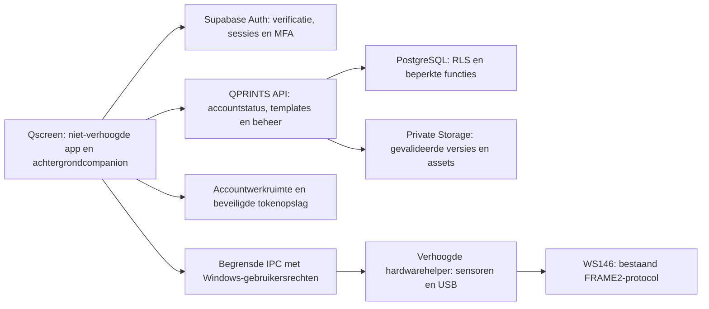

# Qscreen accounts — architectuur en uitvoeringsplan

Status: fase 1, ontwerpvoorstel; geen authenticatie of beveiligingsclaim als geïmplementeerd markeren.

## 1. Inspectie van de bestaande app

Qscreen is een .NET 10 Windows Forms-app met LibreHardwareMonitor, PresentMon en een bestaande USB/FRAME2-verbinding. Er is geen accountserver, gebruikersdatabase, mailprovider, tokenopslag of cloud-authconfiguratie aangetroffen in de repository. De bestaande `ICommunityDesignSource` is een bruikbaar uitbreidingspunt voor een officiële bibliotheek; `LocalTemplateLibrary` blijft de persoonlijke, lokale bron.

De 21 ingebouwde templates zijn bewerkbare projecten met een achtergrond; `.qscreenpack` is een begrensd ZIP-pakket met manifest, project en preview. Bestaande ontwerp- en assetvalidatie blijft nodig, maar de huidige GDI/WinForms-renderer kan niet zomaar naar een Linux-backend worden gekopieerd. Servervalidatie krijgt een afzonderlijk platformonafhankelijk formaatcontract.

Belangrijke migratiepunten:

- `Program.cs` start de achtergrondmeting met `AppContext.BaseDirectory` als datamap. `SettingsWindow`, profielbestanden, concepten, lokale templates en instellingen gebruiken die map eveneens.
- `app.manifest` vraagt `requireAdministrator` voor het gehele proces. Daarmee zouden ook toekomstige login, netwerk- en afbeeldingsverwerking verhoogd draaien.
- `installer/task.ps1` registreert één algemene taak `TempMonitor`, voor aanmelden van Windows-gebruikers, met de hoogste rechten. Dat is nog geen accountgebonden werkruimte of veilige gebruikersgrens.
- De bestaande globale monitor-mutex en exclusieve seriële poorten voorkomen concurrentie, maar kiezen nog geen accountgebonden eigenaar van de hardware.
- Het manifestveld `Author = QPRINTS`, een lokale bestandsnaam of een ingebouwd template-ID bewijst geen officiële cloudherkomst.

De installerwijziging die de layoutstap overslaat blijft behouden. Er komt in deze fase geen verplichte login die bestaande installaties of hardwaremonitoring onderbreekt.

## 2. Voorgestelde backend

Gebruik **beheerde Supabase Auth, PostgreSQL en private Supabase Storage**, met een kleine **ASP.NET Core .NET 10 API** voor beheertaken, publicatie, accountstatus en gecontroleerde downloads. Dat sluit aan op de bestaande C#-code en voorkomt een zelfgebouwde wachtwoord- of tokenuitgever. Het voorstel is nog geen aangemaakt of gekoppeld Supabase-project.

Authenticatie gebruikt de gepubliceerde e-mail/wachtwoordfuncties van Supabase Auth via HTTPS. De donkere Qscreen-login en registratie blijven native. Wachtwoorden worden alleen tijdens het verzoek gebruikt, niet gelogd, lokaal bewaard of door de Qscreen-database gehasht. Bevestiging en herstel openen beheerde HTTPS-pagina's in de systeembrowser. Redirects worden exact toegestaan; geen willekeurige return-URL's of tokens in logbestanden. Een eventuele latere OAuth-login gebruikt authorization code met PKCE, zonder client secret in de desktopapp.

De desktop bevat alleen openbare configuratie: API-origin, Auth-project-URL en publishable key. Een publishable key is geen autorisatiemiddel. Databasewachtwoorden, signing keys, SMTP-geheimen en een service-role/secret key blijven uitsluitend in beheerde serversecrets.

Normale data-aanvragen behouden de geverifieerde gebruikerscontext. De API wordt geen generieke service-role-proxy: zij gebruikt RLS met het gebruikers-token of beperkt geprivilegieerde functies tot expliciete, opnieuw gecontroleerde beheertaken. Rechtstreekse database- of Storage-aanvragen moeten dezelfde rechten respecteren als de API.

## 3. Precies één administrator

De enige toegestane beheeridentiteit is `Qprints@outlook.be`. Deze tekst geeft nergens zelfstandig rechten.

1. Maak de identiteit met een serverzijdige uitnodiging of gecontroleerde registratie aan als gewone gebruiker.
2. Laat de eigenaar de provider-verificatiemail bevestigen en TOTP-MFA instellen. In deze planningsfase wordt geen mail verzonden.
3. Een eenmalig server-/deploymentcommando ontvangt een expliciet account-UUID. Het controleert bij Auth de bevestigde e-mail, de ingeschakelde accountstatus en de geverifieerde MFA-factor.
4. Alleen dat commando mag een rij in `private.admin_identity` aanmaken. Een singleton-primary-key met `CHECK (singleton = true)` staat maximaal één beheeridentiteit toe. Provisionering gebeurt transactioneel en gelijktijdige pogingen worden door de database tegengehouden.
5. Alle andere accounts hebben effectief rol `user`; er bestaat geen publiek schrijfbare rolkolom of endpoint om rollen te veranderen.
6. Iedere beheeractie vereist een geldig provider-token, de gekoppelde UUID, een nog passende bevestigde e-mail, een actieve accountstatus en MFA-niveau `aal2`. Gevoelige acties vragen een verse MFA-bevestiging; een vernieuwde token-`iat` geldt niet als bewijs van een verse login.
7. Een e-mailwijziging, blokkade of verwijderde MFA-factor trekt beheerbevoegdheid in totdat gecontroleerd herstel heeft plaatsgevonden. Bijbehorende databasefuncties mogen alleen noodzakelijke velden uit het afgeschermde Auth-schema lezen.

De client mag een geverifieerde `/me`-respons gebruiken om beheerknoppen te tonen. Een vervalste lokale rol of zichtbaar gemaakte knop verandert geen backendrechten. Serverfuncties controleren de database-identiteit, niet `user_metadata.role`, een meegestuurde e-mail of een verzoekveld `owner_id`.

## 4. Datamodel en toegang

UUID's dienen als identifiers; onvoorspelbare identifiers vervangen geen toegangscontrole.

| Gegeven | Eigenaarschap en beleid |
|---|---|
| Provider `auth.users` | Provider beheert identiteit, wachtwoord en verificatie; geen directe desktoptoegang |
| `account_profiles` | Eigen weergavenaam/avatar bewerkbaar; accountstatus alleen via beheeractie |
| `account_consents` | Versie voorwaarden/privacytekst en instemmingstijd; eigen aanvraag, server schrijft identiteit/tijd |
| `private.admin_identity` | Maximaal één UUID; alleen deployment-/herstelprocedure mag schrijven |
| `template_categories` | Geverifieerde gebruikers lezen zichtbare categorieën; beheerder beheert |
| `official_templates` | Titel, beschrijving, categorie, doelmodellen en gepubliceerde versie; beheerde wijzigingen |
| `official_template_versions` | Onveranderlijke versies, schema/minimale appversie, hashes, package- en previewreferenties |
| `personal_projects` | Alleen eigenaar; optionele cloudsync standaard uit |
| `personal_assets` | Alleen eigenaar; type, grootte en eigen storageprefix, geen vrije bestandspaden |
| `device_registrations` | Alleen eigenaar; uitsluitend vrijwillig geregistreerde naam/model, geen automatische hardwaretelemetrie |
| `admin_audit_events` | Alleen vertrouwde server/database schrijft; beheerder leest, client kan niet wijzigen of wissen |
| `download_totals` | Servergestuurde telling van uitgegeven downloads, geen verborgen FPS- of gebruikslogging |

RLS geldt voor alle blootgestelde tabellen en Storage-objecten, inclusief insert- en updatecontroles. Rollen krijgen alleen noodzakelijke kolomrechten: een profielupdate kan geen `disabled`-veld, eigenaar of rol veranderen. De API deriveert de eigenaar uit de gevalideerde subject-ID. `SECURITY DEFINER`-functies krijgen een vaste `search_path`, expliciete grants en geen algemene uitvoerrechten.

Geactiveerde officiële versies zijn alleen leesbaar voor bevestigde, ingeschakelde accounts. Concepten zijn alleen toegankelijk voor de beheerder met MFA. Officiële publicatie- en verwijderfuncties bevatten hun eigen machtigingscontrole. Privéprojecten/-assets gebruiken overal `owner_id = auth.uid()`; er is standaard geen beheerderstoegang tot de inhoud van persoonlijke projecten.

## 5. Registratie en sessies

- Registratie vraagt e-mail, weergavenaam, wachtwoord, bevestiging en instemming met versies van voorwaarden en privacytekst. De producteigenaar levert de werkelijke teksten en URL's aan; fictieve voorwaarden worden geen productiebeleid.
- Supabase Auth beheert e-mailuniciteit en verificatie. Een onbevestigde identiteit heeft geen volledige app-/cloudtoegang. Rechtstreekse registratie buiten de UI levert evenmin beheerrechten of een voltooid toestemmingsrecord op.
- Registratie, login, verificatie en herstel krijgen provider-rate-limits en anti-misbruikinstellingen. API-limieten gelden daarnaast per endpoint/gebruiker; een clienttimer is geen beveiligingsmaatregel.
- Login/registratie/herstel geven bruikbare status zonder onnodig het bestaan van andere accounts te onthullen. MFA heeft een eigen scherm en herstelprocedure.
- Access tokens blijven bij voorkeur in geheugen. Alleen bij 'sessie onthouden' wordt een refresh token met Windows DPAPI `CurrentUser` of Credential Manager bewaard, buiten de installatiemap, met gebruikersgebonden ACL's.
- Gebruik één refreshproces per sessie, tokenrotatie en atomische vervanging. Log nooit tokens, wachtwoorden, e-maillinks of MFA-codes.
- Uitloggen trekt de sessie bij de provider in, verwijdert lokaal tokenmateriaal en ontkoppelt het actieve account. Verlopen sessies mogen geen API-acties uitvoeren. Download- en bewerkingscache wordt niet als bewijs voor online bevoegdheid behandeld.
- Iedere online aanvraag controleert accountstatus en verificatie. Alleen een Auth-ban of verlopen refresh token is onvoldoende voor onmiddellijke blokkade zolang een eerder access token nog geldig kan zijn.

DPAPI beschermt tegen andere Windows-gebruikers; het biedt geen bescherming tegen malware of een beheerder binnen dezelfde Windows-identiteit.

## 6. Lokale werkruimtes en hardwareproces

Verplaats gebruikersgegevens naar `%LOCALAPPDATA%\QPRINTS\Qscreen\Accounts\<provider-user-uuid>\`. Deel onder in Designs, Drafts, Images, Animations, Devices en Cache. UI en niet-verhoogde achtergrondcompanion gebruiken dezelfde expliciete werkruimte; accounttokens gaan nooit naar de hardwarehelper. Installatiebestanden, tools en ingebouwde assets blijven onder Program Files.

De bestaande één-map-architectuur wordt via een `WorkspacePaths`-contract uitgebreid. Een eenmalige migratie laat de gebruiker bestaande ontwerpen aan het ingelogde account toewijzen, kopieert ze, controleert inhoud en bewaart de bron. Een installatie-update mag ontwerpen niet automatisch aan een willekeurig eerste account koppelen. Nooit persoonsgegevens stilzwijgend uploaden. Cloudsync blijft optioneel en zichtbaar uitgeschakeld totdat zij echt is gekoppeld.

Accountmappen organiseren lokale inhoud, maar twee Qscreen-accounts binnen dezelfde Windows-login vormen geen harde OS-beveiligingsgrens. Voor sterke lokale scheiding zijn afzonderlijke Windows-profielen nodig; cloudgegevens krijgen wel de volledige accountgebonden servercontrole.

Splits de bestaande uitvoerbare app stapsgewijs:

- Niet-verhoogde Studio/companion: aanmelden, projectbestanden, netwerk, rasteren, offline cache en accountgebonden instellingen.
- Beperkte verhoogde helper: sensoren, PresentMon en exclusieve USB-eigendom. Geen auth, HTML, internetdownloads, projectafbeeldingen of willekeurige uitvoer-/bestandspadopdrachten.
- IPC via een named pipe met een expliciete ACL voor de Windows-eigenaar en noodzakelijke beheeridentiteit. Alleen begrensde sensorberichten, allowlisted apparaatinstellingen en exact begrensde RGB565-frames; geen algemeen shell- of bestandsschrijfkanaal.
- Startup en monitoring worden Windows-gebruikersgebonden. Eén gecontroleerde hardware-eigenaar voorkomt COM-conflicten bij meerdere sessies. Gedrag bij standaardgebruikers, UAC, wisselen van Windows-gebruiker en gelijktijdige sessies krijgt aparte tests.

De beeldvorming en FRAME2-pakketten richting ESP32 blijven hetzelfde. Deze accountuitbreiding op zichzelf vereist geen firmwarewijziging.

## 7. Officiële bibliotheek en publiceren

Behoud de lokale bibliotheek; voeg een aparte bron voor officiële cloudtemplates toe. Een lokale kopie mag haar naam of auteur veranderen, maar krijgt daarmee nooit een officiële publicatiebadge. De 21 huidige ingebouwde templates blijven beschikbaar als meegeleverde/offline collectie. Een backendpublicatie ervan is een afzonderlijke beheeractie.

Publicatieproces:

1. Beheerder meldt zich online aan, rondt MFA af en kiest 'Publiceren in QPRINTS-bibliotheek'.
2. De API controleert zijn actuele identiteit, accountstatus en MFA voordat een upload wordt toegestaan.
3. Een begrensde upload gaat naar een private staginglocatie onder een servergekozen ID. Een geldig uploadticket is kort geldig en geeft geen recht om willekeurige objecten te overschrijven.
4. De server controleert ZIP-entryallowlist, uitgepakte en feitelijk gelezen grootte, JSON-schema/diepte, elementen, animatiegrenzen, doelmodel, afbeeldingshandtekeningen/dimensies/frameaantallen en compatibiliteit. Extensie en client-MIME zijn geen bewijs van formaat. Er worden geen scripts uitgevoerd of externe asset-URL's opgehaald.
5. De headless validator gebruikt geen WinForms/GDI op de server. De beeldvalidator/decoder wordt geselecteerd en getest vóór uploadvrijgave; een frontendpreview geldt niet als servervalidatie.
6. Een geslaagde upload maakt een onveranderlijke conceptversie met serverberekende SHA-256 en gevalideerde assetreferenties. Publiceren wijst transactioneel die versie aan en registreert een audit-event.
7. Bevestigde gebruikers kunnen gepubliceerde metadata bekijken en een gecontroleerde download aanvragen. Kopiëren naar My Designs creëert eigen UUID's en een lokale bewerkbare versie, geen bewerkrecht op het origineel.

Officiële bestanden staan in een private bucket. Kies voor gecontroleerde API-downloads; korte signed URL's zijn alleen een bewuste optimalisatie. Niet-publiceren trekt toekomstige downloads in, maar kan reeds gedownloade bestanden niet terughalen. Signed URL's kunnen bovendien geldig blijven tot hun vervaltijd; dit wordt niet als onmiddellijke intrekking voorgesteld.

Vervang externe paden door servergekozen objectkeys. Pakket- en previewdownloads krijgen timeouts, grootte/hashcontrole, tijdelijke bestanden en atomische cachevervanging. Een hash controleert integriteit ten opzichte van vertrouwde metadata; een hash die een gebruiker zelf aanlevert bewijst geen officiële herkomst.

## 8. API-oppervlak en dashboard

| Endpointgroep | Toegang |
|---|---|
| Auth-provider: signup/login/verify/recovery | Providerbeveiliging; nooit roltoekenning door invoervelden |
| `/me`, `/me/consents`, `/me/profile` | Eigen geverifieerde identiteit, beperkte updates |
| `/official/templates`, `/official/templates/{id}/download` | Bevestigde, actieve gebruiker; alleen gepubliceerde versies |
| `/admin/templates`, versie-upload, publish/unpublish/delete | Actieve singleton-beheerder, MFA en gevalideerde invoer |
| `/admin/categories` | Dezelfde beheermachtiging |
| `/admin/users`, disable/reactivate | Dezelfde beheermachtiging; geen algemene endpoint voor rolwijzigingen |
| `/admin/overview`, `/admin/audit` | Dezelfde beheermachtiging; minimale noodzakelijke gegevens |
| Optionele `/me/projects`, `/me/assets`, `/me/devices` | Eigenaar en bevestigde account; cloudsync expliciet ingeschakeld |

Het dashboard toont echte backendgegevens of een duidelijke onbeschikbare status. 'Actieve gebruikers' krijgt vooraf een beperkte definitie, bijvoorbeeld accounts met een geslaagde accountaanvraag in de afgelopen 30 dagen. Downloadtotalen tellen afgeleverde downloads, niet hoe vaak een layout op het scherm staat. Modelstatistieken zijn alleen afkomstig uit vrijwillige apparaatregistratie. Er komt geen automatische upload van sensormetingen, MAC-adressen, FPS of lijsten met actieve programma's.

Audit bevat actor, handeling, object, tijd, resultaat en request-ID, zonder secrets of privéprojectinhoud. Bewaartermijnen en verwijdergedrag worden vooraf vastgelegd. Auditmutaties zijn niet beschikbaar via het gebruikers- of beheerfrontend.

## 9. Offline en storingen

Na een geslaagde eerste login mag een serverondertekend, gebruikersgebonden lokaal toestemmingsbewijs gedurende een begrensde periode, voorlopig zeven dagen, lokale functionaliteit vrijgeven. Het geeft nooit server- of beheerrechten. Uitloggen verwijdert dit bewijs voor het account. Clock rollback en corruptie mogen niet stilzwijgend extra geldigheid creëren; online opnieuw controleren is de veilige fallback.

Offline zijn lokale ontwerpen, assets, gecachte templates en hardwaremonitoring mogelijk binnen dit beleid. Nieuwe downloads, accountbeheer, publiceren en synchronisatie vereisen altijd online verificatie. Een offline pc kan een nieuwe serverblokkade niet direct kennen. Dit is geen DRM-garantie tegen een gewijzigde client en geen beveiligingsgrens voor lokale bestanden; officiële cloudacties blijven volledig servergecontroleerd.

Een netwerkfout stopt de USB-monitor niet. Cachecorruptie verandert geen rol. Een backendfout geeft geen fictieve online gegevens. Verlopen offline toestemming vergrendelt geen eigen projectexports onherstelbaar; heraanmelden en herstelgedrag worden expliciet in de UI uitgewerkt vóór vrijgave.

## 10. Uitvoeringsfasen en vrijgavevoorwaarden

1. **Architectuur (dit document):** stack, dreigingsgrenzen, datamodel, rolregels, migratie en testmatrix vastleggen.
2. **Backendbasis:** stagingproject, Auth/SMTP/redirects, schema/RLS/private buckets, beperkte API en eenmalige adminprovisionering. Eerst misbruiktests uitvoeren.
3. **Desktopauth:** native donkere schermen, providerverzoeken, MFA, sessieopslag en accountstatus. Nog geen verplichte productie-login bij een ongeconfigureerde backend.
4. **Werkruimtes/hardwaregrens:** niet-destructieve migratie en proces/IPC-splitsing; regressies voor gesloten UI, UAC, Windows-gebruikers en USB.
5. **Officiële templates:** backendbron, cache, lokale kopieën en volledig gecontroleerde upload/publicatieflow.
6. **Persoonlijke secties en dashboard:** eigen bestanden, assets, apparaten en echte beheergegevens. Cloudsync blijft een afzonderlijke optionele functie.
7. **Vrijgave:** echte e-mailverificatie/herstel/MFA met de eigenaar, rechtstreekse API/RLS-tests, onafhankelijke beveiligingsreview en installer/hardware-regressie. Pas daarna een accountverplichte publieke release.

Het gedetailleerde testplan staat in [ACCOUNTS-SECURITY-TESTS.md](ACCOUNTS-SECURITY-TESTS.md). Een mocktest, werkende knop of architectuurdocument is geen bewijs dat productie-authenticatie of databasebeveiliging werkt.

## 11. Benodigde configuratie voor uitvoering

Er is een beheerd Supabase-project nodig, bij voorkeur eerst staging in een gekozen regio, plus een API-host en HTTPS-origin voor bevestiging/herstel. Ook nodig: e-mailverzending met geverifieerde afzender, echte voorwaarden/privacy-URL's en de eigenaar die de beheer-mailbox en MFA kan bevestigen.

Project-URL en publishable key zijn openbare appconfiguratie. Geprivilegieerde sleutels worden rechtstreeks als serversecrets ingesteld, nooit in de chat of Windows-app. Er wordt nog geen adminaccount geprovisioneerd, mail verzonden, betaald project aangemaakt of bestaande app gewijzigd in deze ontwerpfase.

## Officiële bronnen voor het voorstel

- [Supabase Auth](https://supabase.com/docs/guides/auth) — providerfuncties en database-integratie.
- [Wachtwoordauthenticatie](https://supabase.com/docs/guides/auth/passwords) — e-mailbevestiging en herstel.
- [MFA](https://supabase.com/docs/guides/auth/auth-mfa) — aanvullende verificatie en assurance levels.
- [Auth-rate-limits](https://supabase.com/docs/guides/auth/rate-limits) — providergrenzen configureren en testen.
- [Row Level Security](https://supabase.com/docs/guides/database/postgres/row-level-security) — databasebeleid, JWT en beheersleutels.
- [Storage-toegangscontrole](https://supabase.com/docs/guides/storage/security/access-control) — private objecten en het omzeilen van RLS door geprivilegieerde sleutels.
- [Windows ProtectedData](https://learn.microsoft.com/en-us/dotnet/api/system.security.cryptography.protecteddata?view=windowsdesktop-10.0) — OS-gebonden tokenbescherming.
